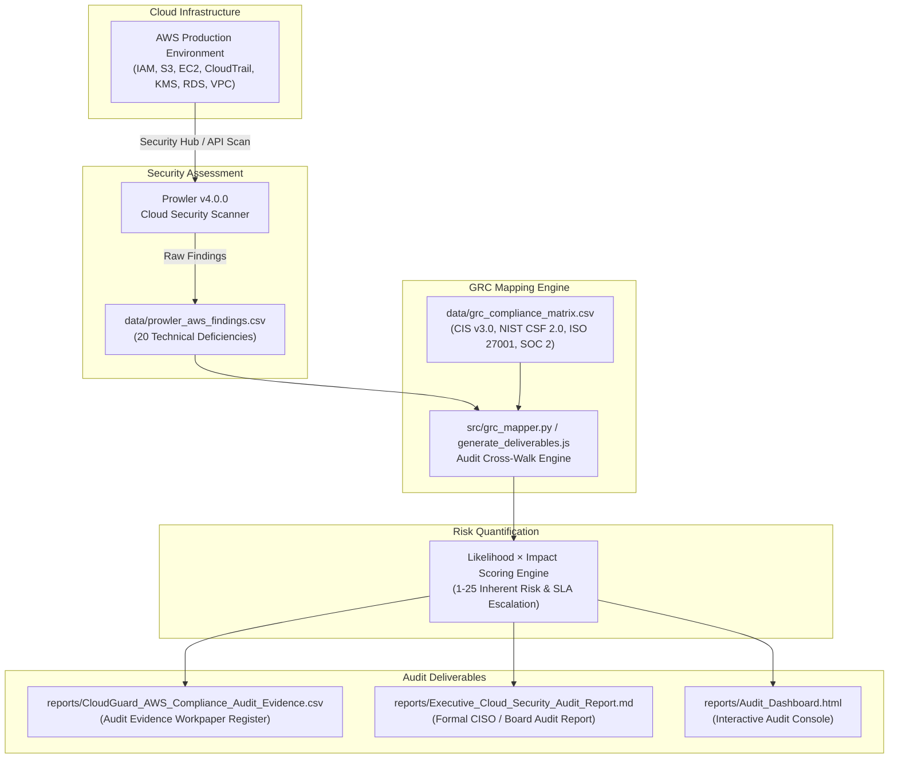

# CloudGuard — Continuous Cloud Security & GRC Assurance Platform
> **Continuous Technical Cloud Security Audit, Multi-Framework GRC Control Mapping, and Executive Risk Governance**

[](#framework-mapping-matrix)
[](https://github.com/prowler-cloud/prowler)
[](#sample-audit-findings--workpaper-register)
[](https://github.com/Nishankhadgi)

---

## 📌 Project Overview

**CloudGuard** is an end-to-end cloud security audit and GRC assurance engine designed to bridge the gap between technical DevOps infrastructure and enterprise risk oversight. 

In modern cloud environments, automated security scanners produce thousands of raw alerts, but internal audit, compliance teams, and the Board of Directors require traceable evidence, control operating effectiveness testing, risk quantification, and remediation accountability.

CloudGuard automates the entire IT audit lifecycle:
$$\text{Technical Cloud Scan} \longrightarrow \text{GRC Control Mapping} \longrightarrow \text{Risk Quantification} \longrightarrow \text{Audit Evidence Workpapers} \longrightarrow \text{Executive Dashboard}$$

---

## 🏗️ Architecture & Audit Workflow



---

## 🎯 Key Capabilities & IT Audit Features

1. **Multi-Framework GRC Control Mapping:**
   - Automatically cross-walks technical cloud misconfigurations to **CIS AWS Foundations Benchmark v3.0**, **NIST CSF 2.0**, **ISO/IEC 27001:2022**, and **AICPA SOC 2 (2017 TSC)**.
2. **Quantitative Risk Scoring ($\text{Likelihood} \times \text{Impact}$):**
   - Evaluates each vulnerability on a 1–25 risk scale, factoring in asset criticality (e.g., IAM root vs. non-sensitive storage).
3. **Formal IT Audit Workpapers:**
   - Issues standardized workpaper references (`WP-IAM-001`, `WP-S3-002`, etc.) with documented control objectives, testing procedures, resource ARNs, and remediation recommendations.
4. **Remediation SLA & Aging Tracker:**
   - Enforces strict closure SLAs:
     - **Critical (Score 20–25):** 7 calendar days
     - **High (Score 12–19):** 30 calendar days
     - **Medium (Score 6–11):** 60 calendar days
     - **Low (Score 1–5):** 90 calendar days
5. **Interactive Executive Audit Console:**
   - Standalone browser-executable dashboard (`reports/Audit_Dashboard.html`) with real-time keyword search, risk tier badges, and CSV export.

---

## 📊 Framework Mapping Matrix

| Technical Finding | AWS Service | CIS AWS v3.0 | NIST CSF 2.0 | ISO 27001:2022 | AICPA SOC 2 |
| :--- | :--- | :--- | :--- | :--- | :--- |
| **Root Account MFA Disabled** | IAM | CIS 1.5 | PR.AA-01 | A.5.15 | CC6.1 |
| **S3 Public Access Block Disabled** | S3 | CIS 2.1.5 | PR.DS-01 | A.8.12 | CC6.6 |
| **SSH (Port 22) Open to 0.0.0.0/0** | EC2 | CIS 5.2 | PR.AC-05 | A.8.20 | CC6.6 |
| **S3 Data Write Events Not Logged** | CloudTrail | CIS 3.8 | DE.AE-03 | A.8.15 | CC7.2 |
| **KMS CMK Key Rotation Disabled** | KMS | CIS 2.8 | PR.DS-02 | A.8.24 | CC6.1 |
| **IAM Access Key Unused >90 Days** | IAM | CIS 1.13 | PR.AA-05 | A.5.17 | CC6.3 |
| **RDS Instance Storage Unencrypted** | RDS | CIS 2.3.1 | PR.DS-01 | A.8.24 | CC6.1 |
| **IAM Policy Wildcard Administrator** | IAM | CIS 1.16 | PR.AA-01 | A.5.15 | CC6.3 |
| **GuardDuty Disabled in Active Region** | GuardDuty | CIS 3.4 | DE.CM-01 | A.8.16 | CC7.2 |
| **VPC Flow Logs Disabled** | VPC | CIS 3.9 | DE.AE-03 | A.8.15 | CC7.2 |

---

## 📁 Repository Structure

```
CloudGuard-AWS-GRC-Audit/
├── data/
│   ├── prowler_aws_findings.csv          # 20 technical cloud security scan findings
│   └── grc_compliance_matrix.csv         # Cross-framework mapping (CIS, NIST, ISO, SOC 2)
├── src/
│   ├── grc_mapper.py                     # Python GRC cross-walk engine
│   ├── risk_quantifier.py                # Quantitative risk calculation & SLA engine
│   ├── generate_audit_report.py          # Report and workpaper export generator
│   ├── cloudguard_cli.py                 # Standalone CLI runner
│   └── generate_deliverables.js          # Zero-dependency Node.js runner
├── reports/
│   ├── Executive_Cloud_Security_Audit_Report.md  # Formal CISO/Audit Committee report
│   ├── CloudGuard_AWS_Compliance_Audit_Evidence.csv # Full audit workpaper register
│   └── Audit_Dashboard.html              # Standalone interactive dashboard
├── tests/
│   └── test_mapper.py                    # Verification unit tests
├── requirements.txt                      # Python dependencies
└── README.md                             # Comprehensive project documentation
```

---

## 🚀 Getting Started

### Option A: Run via Node.js (Zero Dependencies Required)
```bash
# Clone the repository
git clone https://github.com/Nishankhadgi/cloudguard-aws-grc-assurance.git
cd cloudguard-aws-grc-assurance

# Execute the audit pipeline
node src/generate_deliverables.js
```

### Option B: Run via Python CLI
```bash
# Install optional dependencies
pip install -r requirements.txt

# Execute the audit pipeline
python src/cloudguard_cli.py
```

### Viewing Deliverables
1. Double-click `reports/Audit_Dashboard.html` in any web browser to explore the interactive audit console.
2. Open `reports/CloudGuard_AWS_Compliance_Audit_Evidence.csv` in Microsoft Excel or Power BI.
3. Review `reports/Executive_Cloud_Security_Audit_Report.md` for the formal CISO audit memorandum.

---

## 👤 Author & Professional Background

**Nishan Khadgi**  
*Technology Risk Consultant | IT Audit & Cybersecurity GRC Specialist*  
- **LinkedIn:** [linkedin.com/in/nishan-khadgi](https://www.linkedin.com/in/nishan-khadgi)  
- **GitHub:** [github.com/Nishankhadgi](https://github.com/Nishankhadgi)  
- **Email:** `nishankhadgi091@gmail.com`  

---

## ⚖️ Disclaimer

*This project is built for professional portfolio and demonstration purposes to illustrate IT audit, technology risk assessment, and cloud security governance capabilities. Control mappings reference official CIS Benchmarks, NIST CSF 2.0, ISO 27001, and SOC 2 standards, but do not represent a formal certification or regulatory attestation of any third-party infrastructure.*

